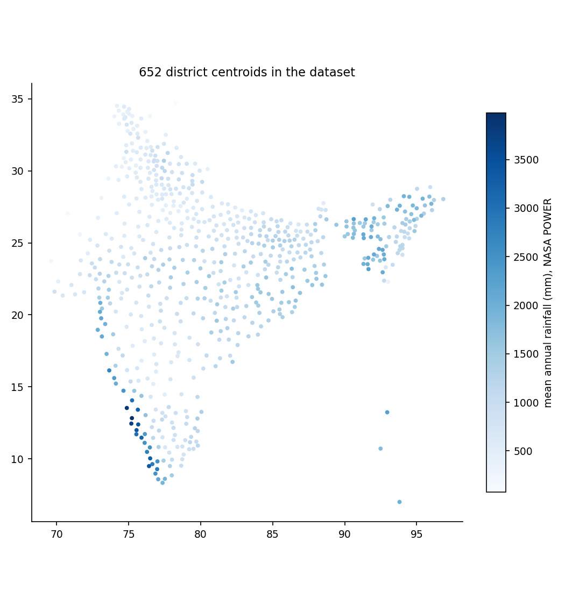
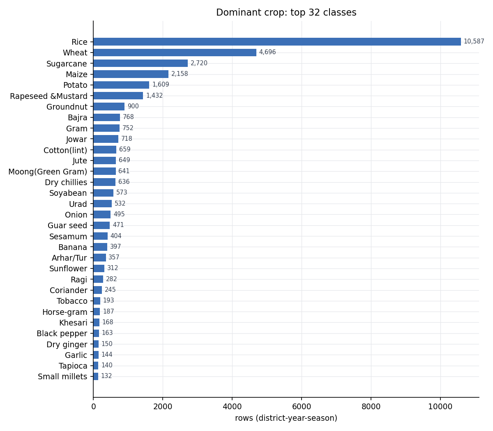

# India District Crop Dataset (1997–2015)

An open, reproducible dataset for **crop recommendation and crop-suitability modelling in India**, built by joining four free public sources at district level.

Each row is one **district × agricultural year × season**, with 20 soil features, 12 climate features and the crop that was actually grown most that season.

| | |
|---|---|
| **Rows × columns** | 34,903 × 48 |
| **Coverage** | 652 districts · 34 states and union territories · crop years 1997–2015 · 6 seasons |
| **Target** | `dominant_crop`: 63 crops, 32 with ≥ 100 rows |
| **Missing values** | 0 in every feature column |
| **Licence** | Data: CC BY 4.0 · Code: MIT |

It was built to replace the widely used 2,200-row Kaggle "Crop Recommendation" dataset, whose rows are synthetic, balanced at exactly 100 per class, and carry no location or time.



---

## Contents

```
data/
  final/
    india_district_crop_dataset_1997_2015.csv   main dataset, 34,903 × 48 (23 MB)
    india_district_crop_dataset_compact.csv     15-column Kaggle-style subset
  processed/
    crop_long_1997_2015.csv                     one row per district-year-season-crop (246,091 rows)
    crop_labels_district_year_season.csv        label table before features are joined
    soil_features_district.csv                  soil features per district (735 polygons)
    climate_features_district_year_season.csv  climate features per district-year-season
    district_crosswalk.csv                      crop-table district name → polygon, with match method
  DATA_DICTIONARY.csv                           every column: type, unit, source, description, stats
docs/
  DATA_CARD.md                                  sources, licences, label definition, limitations
  EDA_SUMMARY.txt                               full exploratory statistics
  figures/                                      six EDA plots
  *.csv                                         EDA tables and sample rows
scripts/                                        the full build pipeline (see Reproduce)
supplementary_datasets/                         Kaggle (Ingle), Benue (Nigeria), Ethiopia; separate licences
```

## Quick start

```python
import pandas as pd

df = pd.read_csv("data/final/india_district_crop_dataset_1997_2015.csv")

soil    = [c for c in df.columns if c.startswith("soil_") and c.endswith("_0_30cm")]
climate = ["temp_mean_c", "temp_max_c", "temp_min_c", "humidity_pct", "rainfall_mm",
           "rain_days_proxy_mm_per_day", "solar_mj_m2_day", "wind_m_s",
           "annual_rainfall_mm", "annual_temp_mean_c", "annual_humidity_pct", "elevation_m"]

keep = df.dominant_crop.value_counts().loc[lambda s: s >= 100].index
d = df[df.dominant_crop.isin(keep)]
X = pd.concat([d[soil + climate], pd.get_dummies(d.season, prefix="season")], axis=1)  # 28 features
y = d.dominant_crop                                                                     # 32 classes
groups = d.district_key                                                                 # use for GroupKFold
```

## Sources

| # | Component | Source | Licence | Used for |
|---|---|---|---|---|
| 1 | Crop area and production | Government of India, Directorate of Economics and Statistics, "District-wise, season-wise crop production statistics", data.gov.in, 1997–98 to 2014–15 (246,091 rows) | Government Open Data License – India | Label |
| 2 | District boundaries | [india_shp_2020](https://github.com/abhatia08/india_shp_2020): 735 districts with Census-2011 and LGD codes | Open | Join key, zonal statistics, centroids |
| 3 | Soil | [ISRIC SoilGrids 2.0](https://soilgrids.org): 10 properties × 3 depths, 1 km over India | CC BY 4.0 | 20 soil features |
| 4 | Climate | [NASA POWER](https://power.larc.nasa.gov) monthly API, 1997–2016, district representative point | Public domain | 11 climate features + elevation |

## How it was built

1. **Name crosswalk.** The 652 district names in the crop table were matched to polygons: 559 exact, 54 by spelling similarity, 39 by hand for renamed or split districts, 0 unmatched. Every match is recorded in `data/processed/district_crosswalk.csv`.
2. **Label.** For each district, crop year and season, plantation crops (coconut, arecanut, tea, coffee, rubber, cashew) and aggregate rows ("Total foodgrain", "Other Kharif pulses") are removed. The crop with the largest sown area becomes `dominant_crop`. Paddy is merged into Rice.
3. **Soil.** Every 1 km SoilGrids pixel inside the district polygon is averaged. The 0–30 cm value is the depth-weighted mean of the 0–5, 5–15 and 15–30 cm layers (weights 5:10:15). One urban polygon with no soil pixels (Mumbai) takes its neighbour's values and is flagged.
4. **Climate.** NASA POWER monthly values are summed (rainfall) or averaged (everything else) over each season's window in that crop year:

   | Kharif | Rabi | Whole Year | Summer | Autumn | Winter |
   |---|---|---|---|---|---|
   | Jun–Oct | Nov–Mar (next yr) | Jun–May (next yr) | Mar–May (next yr) | Sep–Nov | Dec–Feb (next yr) |

5. **Join.** Labels ⋈ soil on `district_key`, then ⋈ climate on `district_key`, `crop_year`, `season`.

## Columns

Full detail for all 48 columns, with units, sources, non-null counts and ranges, is in [`data/DATA_DICTIONARY.csv`](data/DATA_DICTIONARY.csv).

| Group | Columns | Notes |
|---|---|---|
| Identity and location (9) | `district_key`, `Dist_LGD`, `state`, `district`, `crop_year`, `season`, `centroid_lat`, `centroid_lon`, `elevation_m` | `district_key` is the grouping key for cross-validation |
| Soil (20) | `soil_{ph_h2o, total_n_g_kg, soc_g_kg, cec_cmol_kg, clay_pct, sand_pct, silt_pct, bulk_density_kg_dm3, org_c_density_kg_m3, coarse_frag_pct}_{0_5cm, 0_30cm}` | Static per district (652 unique values each) |
| Climate (11) | `temp_mean_c`, `temp_max_c`, `temp_min_c`, `humidity_pct`, `rainfall_mm`, `rain_days_proxy_mm_per_day`, `solar_mj_m2_day`, `wind_m_s`, `annual_rainfall_mm`, `annual_temp_mean_c`, `annual_humidity_pct` | Vary by district, year and season |
| Label and helpers (7) | `dominant_crop` (target), `dominant_share`, `dominant_yield`, `top3_crops`, `crops_share_ge_10pct`, `n_crops`, `total_area_ha` | Helpers are derived from the label; never use them as inputs |
| Flag (1) | `soil_filled_from_nearest` | Non-empty only for Mumbai |

### Missing values

| Column | Non-null | Null | Reason |
|---|---|---|---|
| All soil, climate and location columns | 34,903 | 0 | — |
| `dominant_yield` | 34,858 | 45 | Production not reported in the source |
| `crops_share_ge_10pct` | 34,902 | 1 | No crop reached 10% of area |
| `soil_filled_from_nearest` | 1 | 34,902 | Flag, empty by design |

### Target distribution

| Rice | Wheat | Sugarcane | Maize | Potato | Rapeseed & Mustard | 57 others |
|---|---|---|---|---|---|---|
| 10,587 (30%) | 4,696 (13%) | 2,720 (8%) | 2,158 (6%) | 1,609 (5%) | 1,432 (4%) | 11,701 (34%) |



## Recommended use

- **Group your folds.** Rows from one district share identical soil values. Use `GroupKFold` on `district_key` (or state). A Random Forest scores 0.824 with random 5-fold, 0.709 with district-grouped folds and 0.526 with state-grouped folds; always predicting Rice gives 0.309.
- **Exclude label helpers and coordinates.** `dominant_share`, `dominant_yield`, `top3_crops`, `crops_share_ge_10pct`, `n_crops` and `total_area_ha` are computed from the label. Latitude, longitude, state and district let a model memorise places.
- **Use one soil depth.** The 0–5 cm and 0–30 cm columns are near-duplicates.
- **Report macro-F1 and per-class recall.** Accuracy is dominated by Rice.

## Limitations

1. **No phosphorus or potassium.** SoilGrids does not provide P, K, EC or micronutrients, and SoilGrids total N is not Soil Health Card available N.
2. **District aggregation.** One soil mean and one climate point per district; within-district variation is lost.
3. **Boundary vintage.** 1997–2015 district names are mapped onto 2020 polygons; districts split after 2011 map to one successor.
4. **Observed labels.** The dominant crop reflects irrigation, markets and support prices as well as soil and climate.
5. **Coarse humidity.** NASA POWER is about 0.5° × 0.625°; free gridded humidity from IMD is not available.
6. **2015 is partial.** Only 97 rows; the source ends during that year.
7. **`dominant_yield` units.** The source table mixes units, producing extreme outliers (up to 88,000). It is not intended as a feature.

## Reproduce

Requires Python 3.9+ and about 2 hours, mostly downloads.

```bash
python -m venv .venv && .venv/bin/pip install -r requirements.txt
bash scripts/download_sources.sh                    # crop statistics + district boundaries
.venv/bin/python scripts/fetch_soilgrids.py         # 30 SoilGrids rasters, ~40 min
.venv/bin/python scripts/fetch_nasa_power.py        # 735 API calls, ~60 min
.venv/bin/python scripts/build_district_crosswalk.py
.venv/bin/python scripts/build_crop_labels.py
.venv/bin/python scripts/build_soil_features.py
.venv/bin/python scripts/build_climate_features.py
.venv/bin/python scripts/build_merged_dataset.py
bash supplementary_datasets/kaggle_ingle/download.sh  # only needed for the EDA comparison section
.venv/bin/python scripts/eda.py                     # regenerates docs-style EDA into data/final/eda/
```

Raw downloads go to `data/raw/`, which is git-ignored.

## Supplementary datasets

[`supplementary_datasets/`](supplementary_datasets/) holds three other public crop-recommendation datasets (Kaggle Ingle, Benue Nigeria, Ethiopia) for comparison. They keep their own licences; see the README in each folder.

## Licence

- **Data** in `data/` and `docs/`: [CC BY 4.0](LICENSE). It is derived from CC BY 4.0 (SoilGrids), public-domain (NASA POWER) and Government Open Data License – India (data.gov.in) sources; please also credit those sources.
- **Code** in `scripts/`: [MIT](LICENSE-CODE).
- **Supplementary datasets:** their original licences, listed in each folder.

## Citation

See [`CITATION.cff`](CITATION.cff). Please also cite ISRIC SoilGrids 2.0 (Poggio et al., 2021, *SOIL* 7, 217–240), NASA POWER, and the Government of India crop production statistics.
